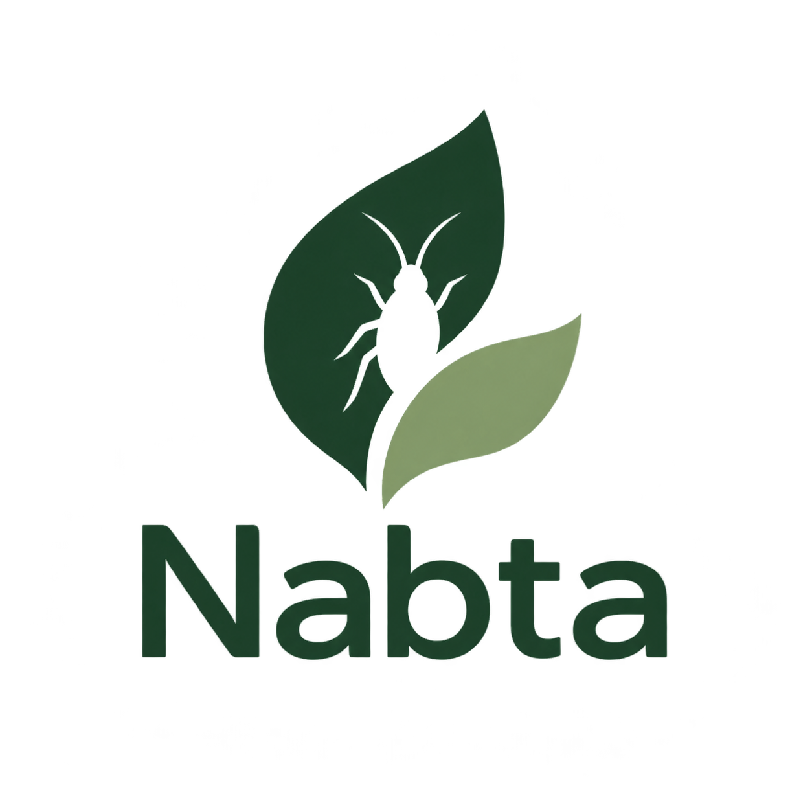
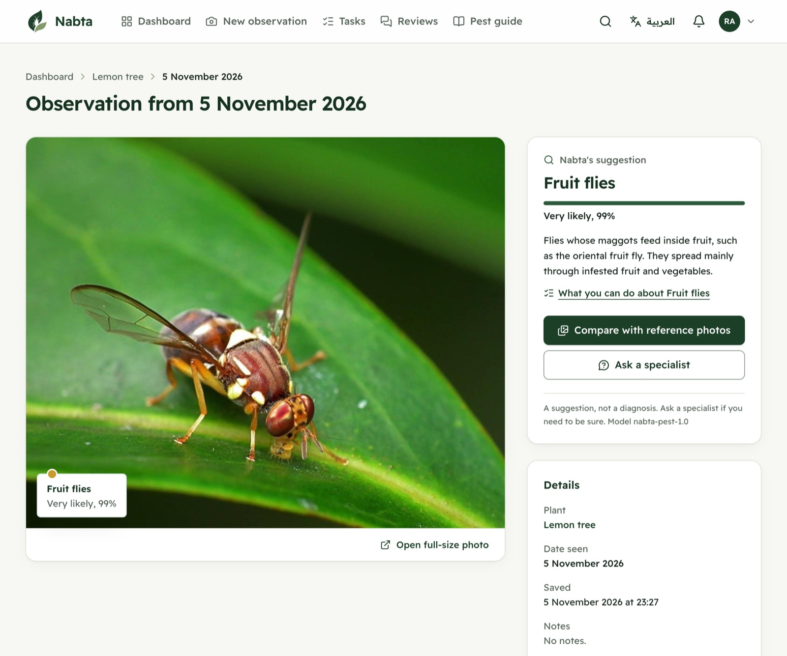
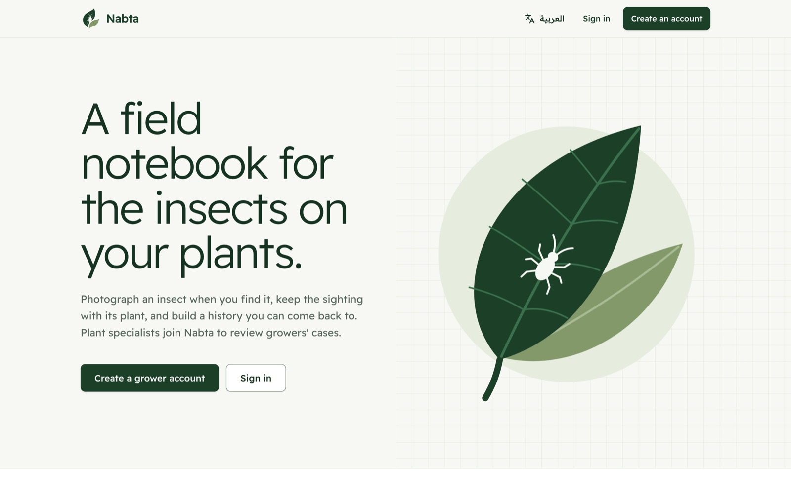
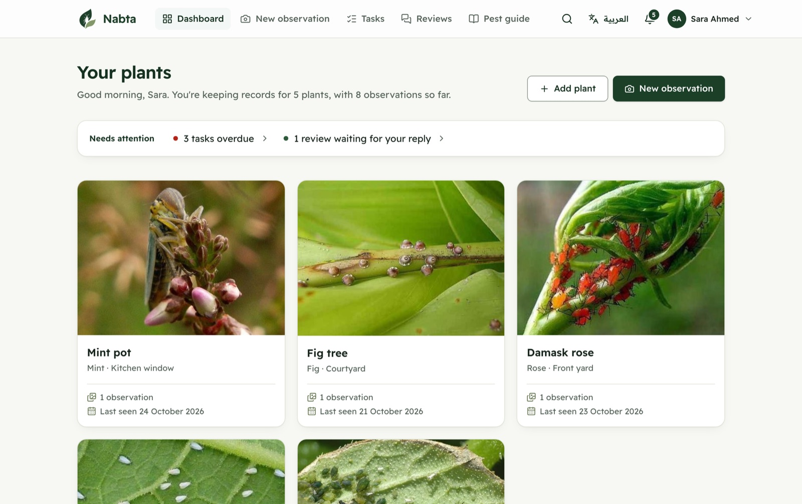
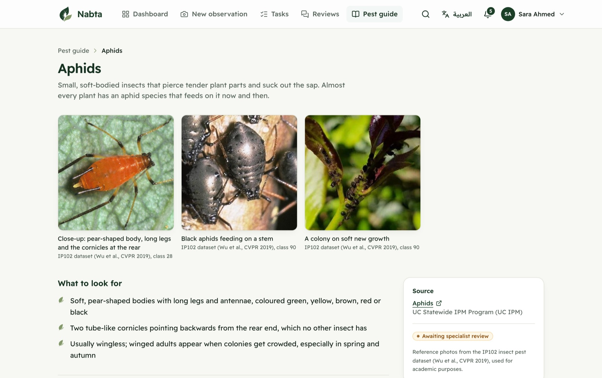
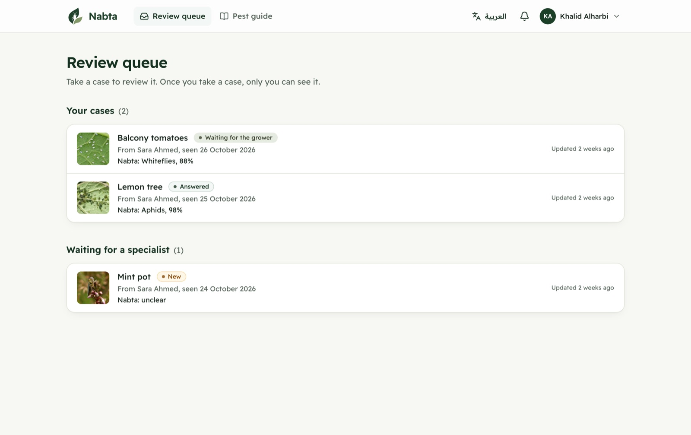
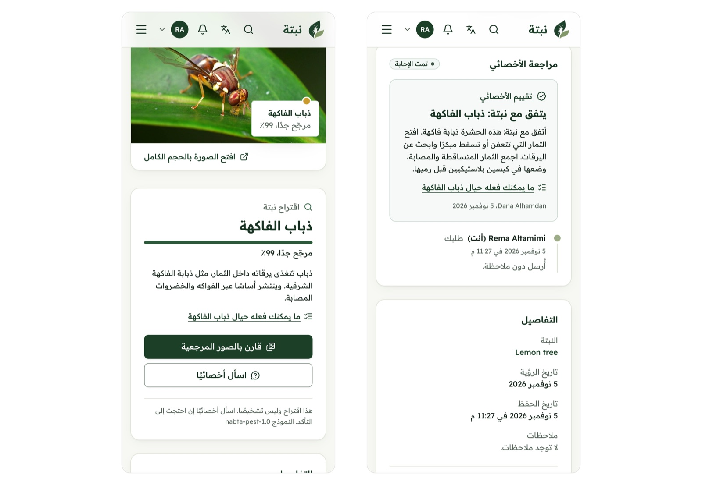
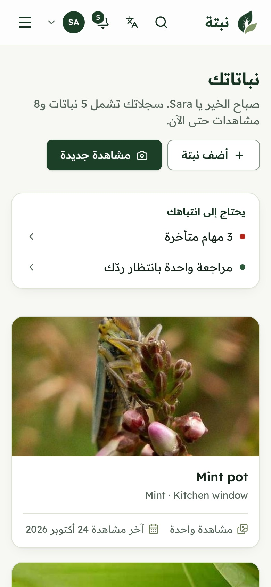
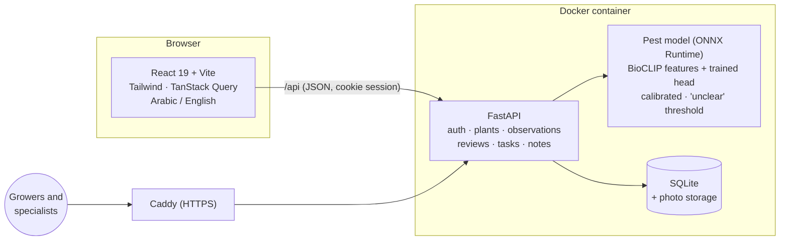

<div align="center">



# Nabta · نبتة

**A field notebook for the insects on your plants.**<br />
Photograph an insect, get a calibrated suggestion of what it is, and ask a plant specialist when you need to be sure.

[](https://nabta.duckdns.org)

[](https://github.com/222511316/Nabta/releases/latest)
[](LICENSE)


[Live demo](https://nabta.duckdns.org) ·
[Features](#features) ·
[Screenshots](#screenshots) ·
[How it works](#how-it-works) ·
[Getting started](#getting-started) ·
[Documentation](#documentation) ·
[Team](#team)

<sub>SE499 Senior Project</sub>

</div>

---

<p align="center">
  
</p>

## About

Home growers in Saudi Arabia often find an insect on a plant and have no quick way to tell what it is, or whether it matters. **Nabta** turns that moment into a record:

1. **Photograph** the insect and save it with the plant and the date.
2. **Get a suggestion.** A pest model picks one of eight common pest categories and shows a calibrated confidence. When it isn't sure, it says the result is *unclear* rather than guessing.
3. **Compare** the photo with reviewed reference photos, and read practical, non-chemical guidance with its sources.
4. **Ask a specialist.** Approved plant specialists take the case, ask questions, and send back a dated assessment, kept apart from the model's suggestion.
5. **Follow up** with tasks, reminders, dated notes and a photo timeline.

The whole app works in **Arabic (right to left) and English**, on phones and desktops.

**Pest categories:** aphids · whiteflies · mealybugs · scale insects · fruit flies · armyworms and cutworms · thrips · locusts and grasshoppers

## Features

| | Sprint 1: application foundation | Sprint 2: identification and review | Sprint 3: guidance, follow-up and release |
| --- | --- | --- | --- |
| **Growers** | Accounts, sign-in, password reset · plant profiles · photo observations · dashboard | Pest suggestion with confidence or "unclear" · reference photo comparison · ask a specialist · track requests with notifications | "What you can do" guidance · tasks and reminders · dated notes · photo timeline · search and "Needs attention" · data deletion and research consent |
| **Specialists** | Separate, protected workspace | Review queue · open a case · ask the grower questions · send an assessment | Approval by the team before seeing cases |
| **Everyone** | Public home page | | Full Arabic (RTL) and English · phone and desktop · accessibility checks (WCAG 2.1 AA) |

All 24 user stories in the project charter are built and tested. See [how the prototype meets the charter](docs/CHARTER_ALIGNMENT.md) for the requirement-by-requirement check.

## Screenshots

<table>
  <tr>
    <td width="50%"><br /><sub><b>Home page.</b> Public landing page in English or Arabic.</sub></td>
    <td width="50%"><br /><sub><b>Grower dashboard.</b> Plants, latest sightings and what needs attention.</sub></td>
  </tr>
  <tr>
    <td width="50%"><br /><sub><b>Pest guide.</b> Reference photos, what to look for, and cited sources.</sub></td>
    <td width="50%"><br /><sub><b>Specialist review queue.</b> Cases waiting for a specialist and cases in progress.</sub></td>
  </tr>
  <tr>
    <td width="50%"><br /><sub><b>Arabic on a phone.</b> Nabta's suggestion and a specialist's assessment, right to left.</sub></td>
    <td width="50%" align="center"><br /><sub><b>Arabic dashboard.</b> The same records in Arabic on a 390 px screen.</sub></td>
  </tr>
</table>

## How it works



The backend serves both the API and the built frontend from one container. In production it runs on a Google Compute Engine VM behind Caddy, which provides HTTPS ([deployment guide](deploy/gcp/DEPLOY_GCP.md)).

### The pest model

A frozen, pretrained biology model, [BioCLIP](https://imageomics.github.io/bioclip/), turns each photo into features, and a small head trained on the [IP102](https://github.com/xpwu95/IP102) dataset picks the category. Temperature scaling calibrates the confidence, and a threshold decides when a result is shown as *unclear*. The backend only needs `onnxruntime`, not PyTorch.

| Model (IP102 test split, Nabta's eight categories) | Test macro F1 | Test accuracy |
| --- | ---: | ---: |
| **BioCLIP + trained head (Nabta)** | **0.828** | **88.4%** |
| ResNet-50 + trained head (in-house baseline) | 0.796 | 84.6% |
| Published IP102 ResNet-50 (Wu et al., 2019), within Nabta's categories | 0.625 | 74.7% |

Near-duplicates of training images were removed from the test split. The full evaluation, with per-category results and the confusion matrix, is in [ml/reports/evaluation.md](ml/reports/evaluation.md).

### Tech stack

| Part | Technologies |
| --- | --- |
| Frontend | React 19, Vite, Tailwind CSS, React Router, TanStack Query, i18next |
| Backend | FastAPI (Python 3.13), SQLAlchemy, Alembic, SQLite, onnxruntime |
| Machine learning | PyTorch, BioCLIP, scikit-learn, ONNX |
| Testing | pytest, Vitest, Testing Library, MSW, Playwright, axe-core |
| Deployment | Docker, Caddy, Google Compute Engine |

### Quality

- **300+ backend tests** (pytest): API, access control, photos, review cases, database migrations and the CLI.
- **170+ frontend tests** (Vitest and Testing Library) on page flows against a mock API.
- **End-to-end tests** (Playwright) of the grower and specialist journeys, specialist approval and accessibility, in **Chromium, Firefox and WebKit** at phone and desktop sizes.
- **Accessibility:** axe-core checks for WCAG 2.1 A and AA in English and Arabic, plus keyboard focus.
- **30+ ML tests** for categories, data selection, duplicates, calibration, metrics and preprocessing parity.

## Getting started

You need **Python 3.13** and **Node.js 22 or newer**.

```bash
# Backend (from backend/)
python -m venv .venv
source .venv/bin/activate          # Windows: .venv\Scripts\activate
pip install -r requirements-dev.txt
alembic upgrade head
uvicorn app.main:app --reload --port 8000

# Frontend (from frontend/, in a second terminal)
npm install
npm run dev
```

Then open http://localhost:5173. The model files are too large for git; build them with [ml/README.md](ml/README.md). Without a model, everything else works.

For demo data, step-by-step instructions and the team's commands, see [HOW_TO_RUN.md](HOW_TO_RUN.md) and the [developer guide](docs/DEVELOPMENT.md).

## Project timeline

The project was delivered in three sprints. Each sprint has its own branch, release and milestone.

| Sprint | Stories | Branch | Release |
| --- | --- | --- | --- |
| 1: Application foundation | US01–US08 | [`sprint-1`](https://github.com/222511316/Nabta/tree/sprint-1) | [v0.1.0](https://github.com/222511316/Nabta/releases/tag/v0.1.0) |
| 2: Pest identification and specialist review | US09–US16 | [`sprint-2`](https://github.com/222511316/Nabta/tree/sprint-2) | [v0.2.0](https://github.com/222511316/Nabta/releases/tag/v0.2.0) |
| 3: Guidance, follow-up and release | US17–US24 | [`sprint-3`](https://github.com/222511316/Nabta/tree/sprint-3) | [v1.0.0](https://github.com/222511316/Nabta/releases/tag/v1.0.0) |

Each user story is tracked as an [issue](https://github.com/222511316/Nabta/issues?q=is%3Aissue) under its sprint's [milestone](https://github.com/222511316/Nabta/milestones?state=closed).

## Repository layout

```
backend/    FastAPI app, database migrations, pest content, tests
frontend/   React app, translations (en/ar), unit and end-to-end tests
ml/         training, evaluation and export of the pest model, with reports
docs/       design specs, charter alignment, deployment, developer guide
deploy/gcp/ production setup on Google Compute Engine (Docker Compose + Caddy)
Dockerfile  the whole app in one container
```

## Documentation

| Document | What it covers |
| --- | --- |
| [HOW_TO_RUN.md](HOW_TO_RUN.md) | Step-by-step setup and running, for anyone |
| [docs/DEVELOPMENT.md](docs/DEVELOPMENT.md) | Developer guide: demo data, roles, specialist approval, content review, tests, layout, migrations |
| [docs/superpowers/specs/](docs/superpowers/specs/) | Design specs and API contracts for Sprints 1, 2 and 3 |
| [docs/CHARTER_ALIGNMENT.md](docs/CHARTER_ALIGNMENT.md) | How the prototype meets each charter requirement |
| [docs/DEPLOY.md](docs/DEPLOY.md) · [deploy/gcp/](deploy/gcp/DEPLOY_GCP.md) | Docker image and the Google Cloud deployment |
| [ml/README.md](ml/README.md) | Rebuilding and evaluating the pest model |

## Team

| Name | |
| --- | --- |
| Rema Altamimi | SE499 team member |
| Danah Alfaris | SE499 team member |
| Alanoud Almubarak | SE499 team member |
| Dana Alhamdan | SE499 team member |
| Rema Alsabhan ([@222511316](https://github.com/222511316)) | SE499 team member |

**Supervisor:** Dr. Suad Alramouni

## Acknowledgements

- **IP102** insect pest dataset: Wu et al., *IP102: A Large-Scale Benchmark Dataset for Insect Pest Recognition*, CVPR 2019. Used for training, evaluation and reference photos, for academic purposes.
- **BioCLIP** by the Imageomics Institute, the pretrained model behind Nabta's image features.
- **UC Statewide IPM Program (UC IPM)** and **USDA APHIS**, the sources of the pest guide's descriptions and guidance.

Nabta gives suggestions, not diagnoses. The pest content and the Arabic translation are marked in the app as awaiting review by a plant specialist and a native speaker on the team.

## License

Released under the [MIT License](LICENSE).
