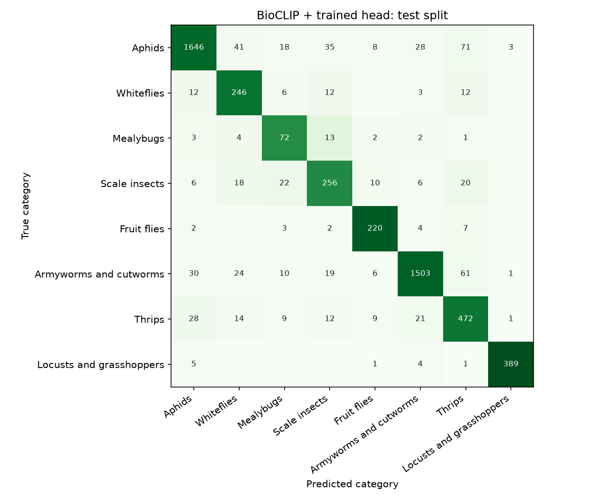

# Nabta pest model: evaluation

Generated by `python -m nabta_ml.train` on 2026-10-18. Every number below is on the fixed IP102 test split of Nabta's eight categories, with near-duplicates of training and validation images removed (see [audit.md](audit.md)). Choices were made on the validation split only.

## Result

| Model | Validation macro F1 | Test macro F1 | Test accuracy |
| --- | ---: | ---: | ---: |
| BioCLIP + trained head (chosen) | 0.810 | 0.828 | 88.4% |
| ResNet-50 + trained head (baseline) | 0.778 | 0.796 | 84.6% |
| BioCLIP zero-shot, no training | – | 0.591 | 72.3% |
| Published IP102 ResNet-50 (Wu et al., 2019), within Nabta's categories | – | 0.625 | 74.7% |
| Published IP102 ResNet-50 (Wu et al., 2019), any of its 102 classes | – | 0.545 | 48.4% |

**Charter KPI (§8), met:** the chosen model's test macro F1 is 0.828. Baselines on the same test split: the published IP102 ResNet-50 within Nabta's categories 0.625 (+0.203); the in-house ResNet-50 0.796 (+0.033).

The published model's preprocessing isn't documented, so the better of two standard choices on a validation sample was used (resize to 224 × 224). Unrestricted, it named a class outside Nabta's categories for 43.3% of the test photos.

## Per category (BioCLIP + trained head, test split)

| Category | Precision | Recall | F1 | Test images |
| --- | ---: | ---: | ---: | ---: |
| Aphids | 0.950 | 0.890 | 0.919 | 1850 |
| Whiteflies | 0.709 | 0.845 | 0.771 | 291 |
| Mealybugs | 0.514 | 0.742 | 0.608 | 97 |
| Scale insects | 0.734 | 0.757 | 0.745 | 338 |
| Fruit flies | 0.859 | 0.924 | 0.891 | 238 |
| Armyworms and cutworms | 0.957 | 0.909 | 0.932 | 1654 |
| Thrips | 0.732 | 0.834 | 0.780 | 566 |
| Locusts and grasshoppers | 0.987 | 0.973 | 0.980 | 400 |

## Confusion matrix

Rows are the true category and columns the prediction; colour shows the share of each row.



| True \ predicted | Aphids | Whiteflies | Mealybugs | Scale insects | Fruit flies | Armyworms and cutworms | Thrips | Locusts and grasshoppers |
| --- | ---: | ---: | ---: | ---: | ---: | ---: | ---: | ---: |
| Aphids | 1646 | 41 | 18 | 35 | 8 | 28 | 71 | 3 |
| Whiteflies | 12 | 246 | 6 | 12 | 0 | 3 | 12 | 0 |
| Mealybugs | 3 | 4 | 72 | 13 | 2 | 2 | 1 | 0 |
| Scale insects | 6 | 18 | 22 | 256 | 10 | 6 | 20 | 0 |
| Fruit flies | 2 | 0 | 3 | 2 | 220 | 4 | 7 | 0 |
| Armyworms and cutworms | 30 | 24 | 10 | 19 | 6 | 1503 | 61 | 1 |
| Thrips | 28 | 14 | 9 | 12 | 9 | 21 | 472 | 1 |
| Locusts and grasshoppers | 5 | 0 | 0 | 0 | 1 | 4 | 1 | 389 |

## Uncertainty: when Nabta says "unclear"

**The rule.** A photo is shown as identified only when it is *familiar* (its features have a cosine similarity of at least 0.617 with at least one training photo) **and** its top category has a probability of at least 50%. Anything else is "unclear", with the closest matches and the specialist route. The 50% floor was fixed in advance (an identified result must be more likely than not); the familiarity cut-off was chosen on validation to balance accepting supported insects against rejecting the tuning group of unsupported insects (35 IP102 classes).

| With Nabta's rule | Validation | Test |
| --- | ---: | ---: |
| Supported insects accepted | 71.8% | 73.3% |
| Accuracy of accepted results | 95.2% | 94.7% |
| Unsupported insects rejected | 84.3% (tuning group) | 86.9% (held-out group) |

The held-out group (34 other IP102 classes, 3000 test images) was never seen while choosing the rule, so its rejection rate is the honest estimate for insect types Nabta doesn't know (charter R03).

**Why familiarity.** Three scores were compared for telling supported from unsupported insects; the nearest-training-photo similarity was clearly best on validation (AUROC, 0.5 = chance):

| Score | Validation AUROC | Test AUROC |
| --- | ---: | ---: |
| Top probability | 0.758 | 0.789 |
| Top logit | 0.753 | 0.780 |
| Similarity to the nearest training photo | 0.857 | 0.874 |

With confidence alone (best threshold 0.911 on validation), the test split would accept 63.1% of supported insects and reject 81.6% of the held-out group, against 73.3% and 86.9% with Nabta's rule.

**Calibration.** Temperature scaling (T = 1.254, fitted on validation) gives a test expected calibration error of 2.0%, against 1.6% without it (no improvement on test; both are low). Shown confidences can be read as probabilities.

Unsuitable photos (test photos made unusable on purpose):

| Photos | Images | Shown as unclear |
| --- | ---: | ---: |
| Blurred | 200 | 99.5% |
| Dark | 200 | 82.5% |

## Data

| Group | Images | Used for |
| --- | ---: | --- |
| Train | 12988 (+12988 augmented views) | fitting the head |
| Validation | 1846 | regularisation, temperature, the familiarity cut-off, model choice |
| Test | 5434 | the results above |
| Unsupported, tuning group | 1906 (35 classes) | choosing the familiarity cut-off |
| Unsupported, held-out group | 3000 (34 classes) | measuring rejection |

1400 validation and test images were excluded as near-duplicates of earlier splits.

## How the model was chosen

Each backbone's head is a class-balanced logistic regression on unit-length features; its regularisation strength C was chosen on validation macro F1:

| Backbone | C = 0.3 | C = 1.0 | C = 3.0 | C = 10.0 | C = 30.0 | C = 100.0 | Features |
| --- | ---: | ---: | ---: | ---: | ---: | ---: | ---: |
| BioCLIP + trained head | 0.779 | 0.794 | 0.804 | 0.810 | 0.810 | 0.804 | 512 |
| ResNet-50 + trained head | 0.701 | 0.735 | 0.757 | 0.772 | 0.778 | 0.775 | 2048 |

The backbone with the higher validation macro F1 is chosen; on a tie the smaller model wins (charter §18: performance, then size and deployment needs).

Zero-shot prompts: aphids: a photo of aphid., a photo of Aphididae.; whiteflies: a photo of whitefly., a photo of Aleyrodidae.; mealybugs: a photo of mealybug., a photo of Pseudococcidae.; scale_insects: a photo of scale insect., a photo of Coccoidea.; fruit_flies: a photo of fruit fly., a photo of Tephritidae.; armyworms_cutworms: a photo of armyworm caterpillar., a photo of cutworm., a photo of Noctuidae.; thrips: a photo of thrips., a photo of Thysanoptera.; locusts: a photo of grasshopper., a photo of locust., a photo of Acrididae.

## Limits

- These are benchmark photos (IP102), not growers' own photos. Results on photos collected from growers will be reported separately (charter §8).
- The audit found some label noise (drawings, damage-only photos, mixed life stages); see [label-check.md](label-check.md).
- Rejection is measured on insects from IP102's other classes; insects from outside IP102 may behave differently.

## Reproduce

```
python -m nabta_ml.prepare
python -m nabta_ml.audit
python -m nabta_ml.features --backbone bioclip
python -m nabta_ml.features --backbone resnet50 --no-augment
python -m nabta_ml.official  # needs resnet50_0.497.pkl, see ml/README.md
python -m nabta_ml.train
python -m nabta_ml.export
```

Seed 2026; dataset IP102 v1.1 from https://huggingface.co/datasets/EnmmmmOvO/insect-pest-dataset.
